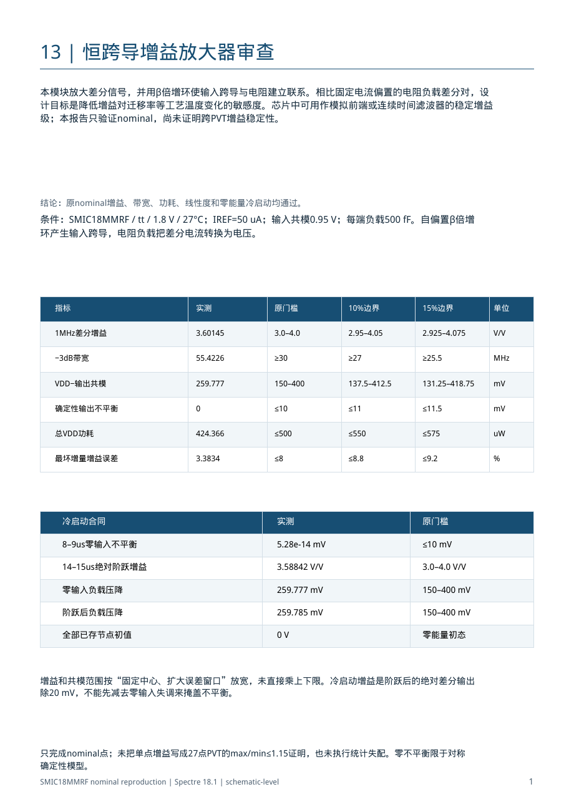
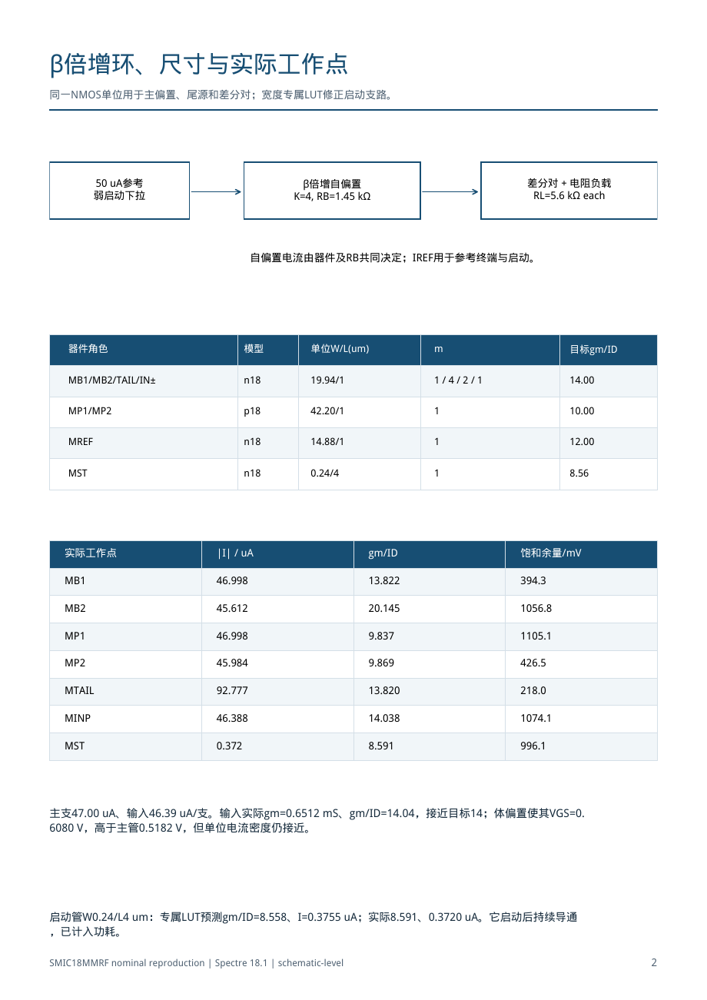
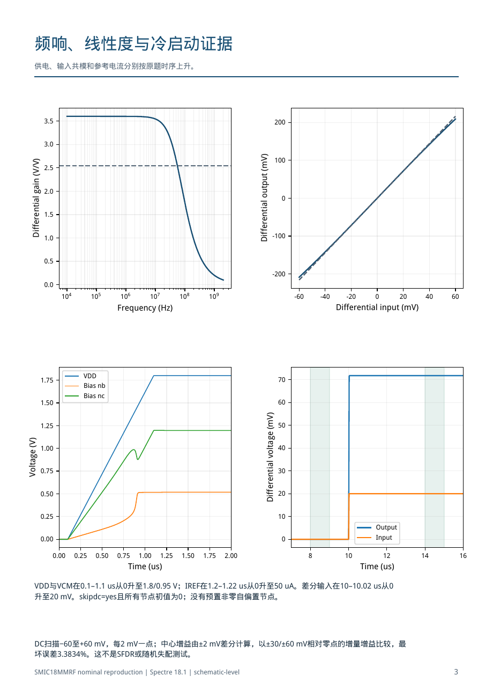
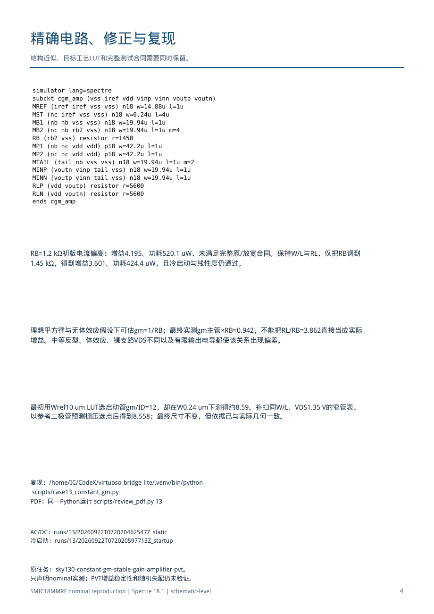
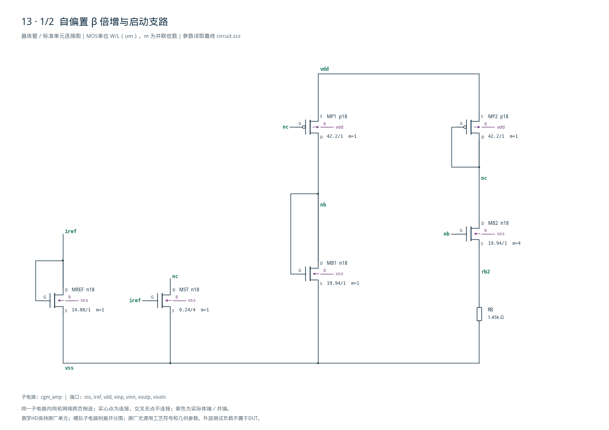
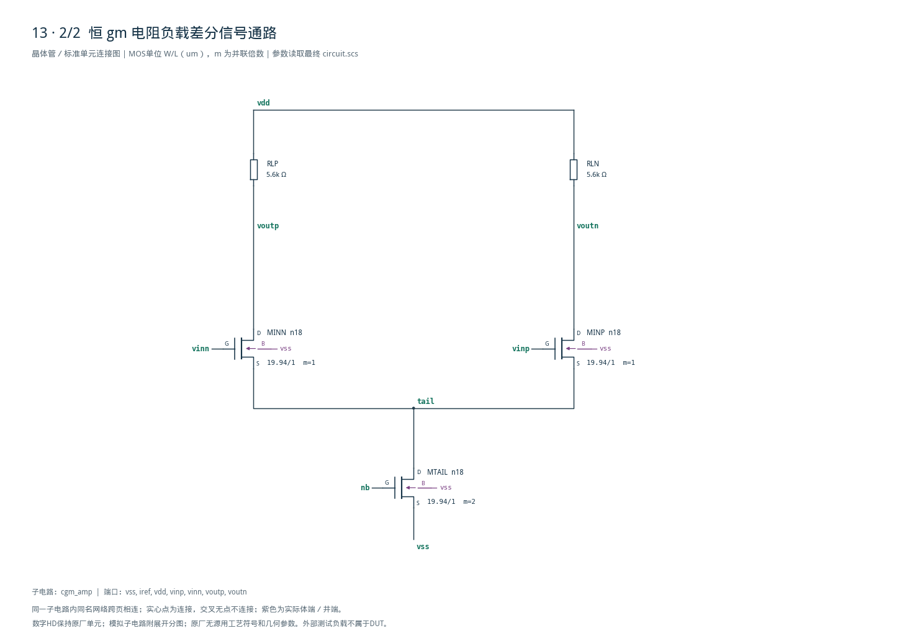

# 13-constant-gm 审查报告

本Markdown根据已交付PDF的可选文字与表格恢复，保留可编辑正文和表格；原图通过页面预览及完整图纸引用保留。旧版未保存报告MD，因此这是补建版本，不是当时PDF的编译输入。PDF和实测数据未改动。

[对应审查PDF](review.pdf) · [最终网表](circuit.scs) · [实测结果](latest_results.json) · [验收合同](contract.json)

## 第1页 · 13 | 恒跨导增益放大器审查

本模块放大差分信号，并用β倍增环使输入跨导与电阻建立联系。相比固定电流偏置的电阻负载差分对，设计目标是降低增益对迁移率等工艺温度变化的敏感度。芯片中可用作模拟前端或连续时间滤波器的稳定增益级；本报告只验证nominal，尚未证明跨PVT增益稳定性。

结论：原nominal增益、带宽、功耗、线性度和零能量冷启动均通过。条件：SMIC18MMRF / tt / 1.8 V / 27°C；IREF=50 uA；输入共模0.95 V；每端负载500 fF。自偏置β倍增环产生输入跨导，电阻负载把差分电流转换为电压。

| 指标 | 实测 | 原门槛 | 10%边界 | 15%边界 | 单位 |
| --- | --- | --- | --- | --- | --- |
| 1MHz差分增益 | 3.60145 | 3.0–4.0 | 2.95–4.05 | 2.925–4.075 | V/V |
| −3dB带宽 | 55.4226 | ≥30 | ≥27 | ≥25.5 | MHz |
| VDD−输出共模 | 259.777 | 150–400 | 137.5–412.5 | 131.25–418.75 | mV |
| 确定性输出不平衡 | 0 | ≤10 | ≤11 | ≤11.5 | mV |
| 总VDD功耗 | 424.366 | ≤500 | ≤550 | ≤575 | uW |
| 最坏增量增益误差 | 3.3834 | ≤8 | ≤8.8 | ≤9.2 | % |

| 冷启动合同 | 实测 | 原门槛 |
| --- | --- | --- |
| 8–9us零输入不平衡 | 5.28e-14 mV | ≤10 mV |
| 14–15us绝对阶跃增益 | 3.58842 V/V | 3.0–4.0 V/V |
| 零输入负载压降 | 259.777 mV | 150–400 mV |
| 阶跃后负载压降 | 259.785 mV | 150–400 mV |
| 全部已存节点初值 | 0 V | 零能量初态 |

增益和共模范围按“固定中心、扩大误差窗口”放宽，未直接乘上下限。冷启动增益是阶跃后的绝对差分输出除20 mV，不能先减去零输入失调来掩盖不平衡。

只完成nominal点；未把单点增益写成27点PVT的max/min≤1.15证明，也未执行统计失配。零不平衡限于对称确定性模型。



## 第2页 · β倍增环、尺寸与实际工作点

同一NMOS单位用于主偏置、尾源和差分对；宽度专属LUT修正启动支路。

| 器件角色 | 模型 | 单位W/L(um) | m | 目标gm/ID |
| --- | --- | --- | --- | --- |
| MB1/MB2/TAIL/IN± | n18 | 19.94/1 | 1 / 4 / 2 / 1 | 14.00 |
| MP1/MP2 | p18 | 42.20/1 | 1 | 10.00 |
| MREF | n18 | 14.88/1 | 1 | 12.00 |
| MST | n18 | 0.24/4 | 1 | 8.56 |

| 实际工作点 | \|I\| / uA | gm/ID | 饱和余量/mV |
| --- | --- | --- | --- |
| MB1 | 46.998 | 13.822 | 394.3 |
| MB2 | 45.612 | 20.145 | 1056.8 |
| MP1 | 46.998 | 9.837 | 1105.1 |
| MP2 | 45.984 | 9.869 | 426.5 |
| MTAIL | 92.777 | 13.820 | 218.0 |
| MINP | 46.388 | 14.038 | 1074.1 |
| MST | 0.372 | 8.591 | 996.1 |

主支47.00 uA、输入46.39 uA/支。输入实际gm=0.6512 mS、gm/ID=14.04，接近目标14；体偏置使其VGS=0.6080 V，高于主管0.5182 V，但单位电流密度仍接近。

启动管W0.24/L4 um：专属LUT预测gm/ID=8.558、I=0.3755 uA；实际8.591、0.3720 uA。它启动后持续导通，已计入功耗。

<details>
<summary>图内标注与坐标文字（按原页保留）</summary>

```text
50 uA参考
差分对 + 电阻负载
β倍增自偏置
弱启动下拉
K=4, RB=1.45 kΩ
RL=5.6 kΩ each
自偏置电流由器件及RB共同决定；IREF用于参考终端与启动。
```

</details>



## 第3页 · 频响、线性度与冷启动证据

供电、输入共模和参考电流分别按原题时序上升。

VDD与VCM在0.1–1.1 us从0升至1.8/0.95 V；IREF在1.2–1.22 us从0升至50 uA。差分输入在10–10.02 us从0升至20 mV。skipdc=yes且所有节点初值为0；没有预置非零自偏置节点。

DC扫描−60至+60 mV，每2 mV一点；中心增益由±2 mV差分计算，以±30/±60 mV相对零点的增量增益比较，最坏误差3.3834%。这不是SFDR或随机失配测试。

<details>
<summary>图内标注与坐标文字（按原页保留）</summary>

```text
3.5
200
3.0
100
2.5
2.0
0
1.5
Differential gain (V/V)
-100
1.0
Differential output (mV)
0.5
-200
0.0
4
5
6
7
8
9
10
10
10
10
10
10
-60
-40
-20
0
20
40
60
Differential input (mV)
Frequency (Hz)
VDD
1.75
70
Bias nb
Bias nc
60
1.50
50
1.25
40
1.00
0.75
30
Voltage (V)
0.50
20
Differential voltage (mV)
0.25
10
Output
Input
0.00
0
0.00
0.25
0.50
0.75
1.00
1.25
1.50
1.75
2.00
8
10
12
14
16
Time (us)
Time (us)
```

</details>



## 第4页 · 精确电路、修正与复现

结构近似、目标工艺LUT和完整测试合同需要同时保留。

```text
simulator lang=spectre
subckt cgm_amp (vss iref vdd vinp vinn voutp voutn)
MREF (iref iref vss vss) n18 w=14.88u l=1u
MST (nc iref vss vss) n18 w=0.24u l=4u
MB1 (nb nb vss vss) n18 w=19.94u l=1u
MB2 (nc nb rb2 vss) n18 w=19.94u l=1u m=4
RB (rb2 vss) resistor r=1450
MP1 (nb nc vdd vdd) p18 w=42.2u l=1u
MP2 (nc nc vdd vdd) p18 w=42.2u l=1u
MTAIL (tail nb vss vss) n18 w=19.94u l=1u m=2
MINP (voutn vinp tail vss) n18 w=19.94u l=1u
MINN (voutp vinn tail vss) n18 w=19.94u l=1u
RLP (vdd voutp) resistor r=5600
RLN (vdd voutn) resistor r=5600
ends cgm_amp
```

RB=1.2 kΩ初版电流偏高：增益4.195、功耗520.1 uW，未满足完整原/放宽合同。保持W/L与RL，仅把RB调到1.45 kΩ，得到增益3.601、功耗424.4 uW，且冷启动与线性度仍通过。

理想平方律与无体效应假设下可估gm≈1/RB；最终实测gm主管×RB≈0.942，不能把RL/RB=3.862直接当成实际增益。中等反型、体效应、镜支路VDS不同以及有限输出电导都使该关系出现偏差。

最初用Wref10 um LUT选启动管gm/ID=12，却在W0.24 um下测得约8.59。补扫同W/L、VDS1.35 V的窄管表，以参考二极管预测栅压选点后得到8.558；最终尺寸不变，但依据已与实际几何一致。

复现：/home/IC/CodeX/virtuoso-bridge-lite/.venv/bin/python scripts/case13\_constant\_gm.py PDF：同一Python运行 scripts/review\_pdf.py 13

AC/DC：runs/13/20260922T072020462547Z\_static冷启动：runs/13/20260922T072020597713Z\_startup

原任务：sky130-constant-gm-stable-gain-amplifier-pvt。只声明nominal实测；PVT增益稳定性和随机失配仍未验证。



## 完整最终网表

以下直接引用随报告保存的circuit.scs，避免PDF视觉折行改变网表。

```spectre
// Self-biased beta multiplier, density-matched input pair and resistor loads.
simulator lang=spectre
subckt cgm_amp (vss iref vdd vinp vinn voutp voutn)
MREF (iref iref vss vss) n18 w=14.88u l=1u
MST (nc iref vss vss) n18 w=0.24u l=4u
MB1 (nb nb vss vss) n18 w=19.94u l=1u
MB2 (nc nb rb2 vss) n18 w=19.94u l=1u m=4
RB (rb2 vss) resistor r=1450
MP1 (nb nc vdd vdd) p18 w=42.2u l=1u
MP2 (nc nc vdd vdd) p18 w=42.2u l=1u
MTAIL (tail nb vss vss) n18 w=19.94u l=1u m=2
MINP (voutn vinp tail vss) n18 w=19.94u l=1u
MINN (voutp vinn tail vss) n18 w=19.94u l=1u
RLP (vdd voutp) resistor r=5600
RLN (vdd voutn) resistor r=5600
ends cgm_amp
```

## 完整电路图

[全部分图PDF](schematic/sheets.pdf) · [电路总图](schematic/full.pdf) · [端子连接](schematic/connectivity.json)




